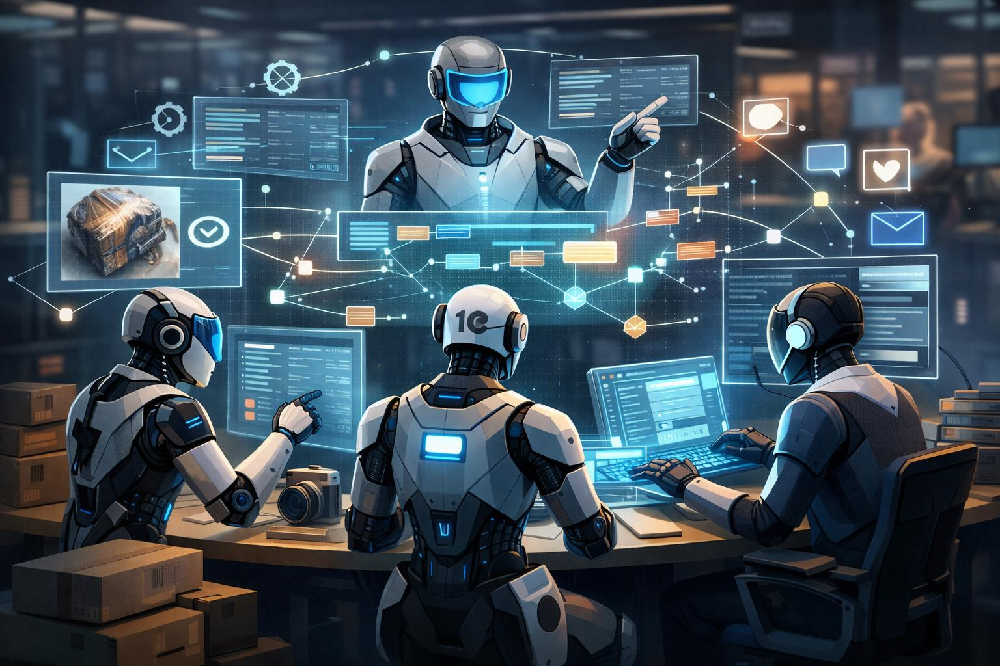
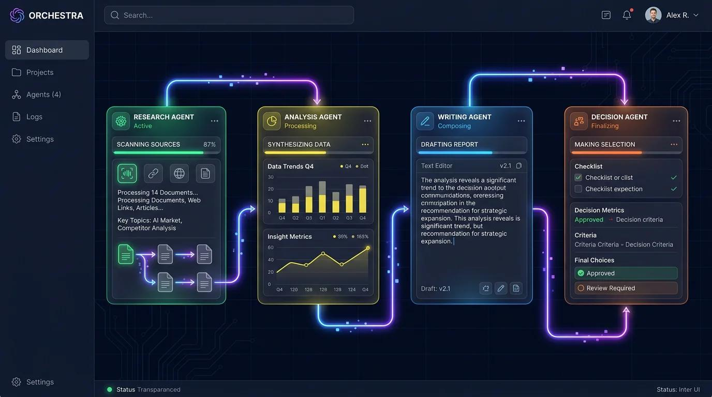
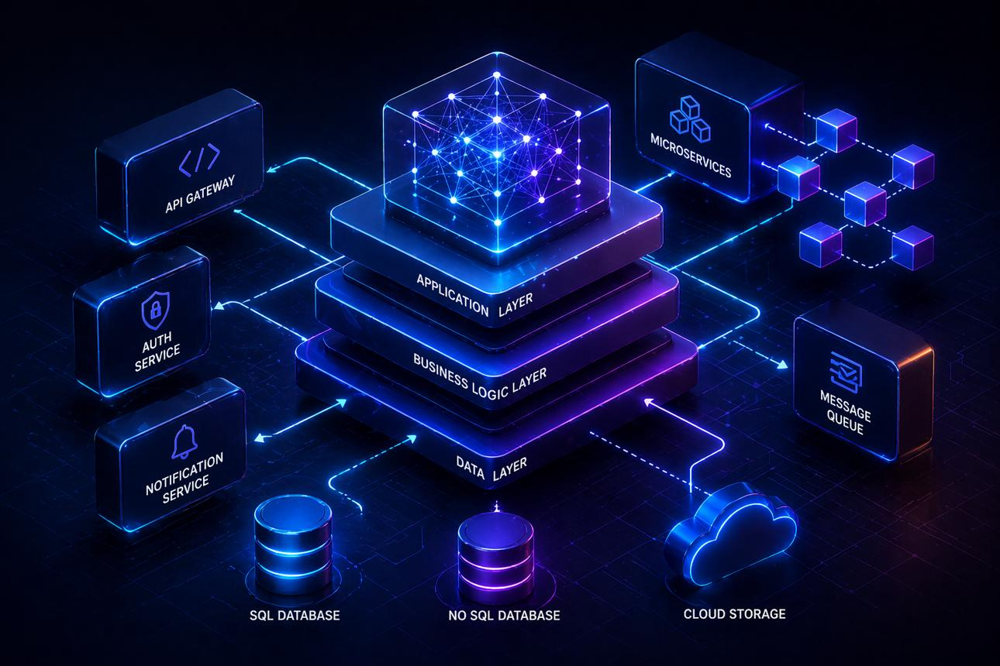

# 🤖 Local AI Team

### Your infrastructure. Your models. Your AI team.

A local-first, multi-agent AI orchestration platform.

[Architecture](#-architecture) · [Features](#-features) · [Roadmap](#-roadmap) · [Security](#-security)

---

## 🚀 About the Project

Local AI Team is an open-source project focused on building a platform for creating, coordinating and managing teams of AI agents.

The vision is to bring together local language models, intelligent agents, task orchestration and secure workspace management in one unified environment.

The platform is designed around local-first infrastructure, with [Ollama](https://ollama.com/) as an intended model runtime.

## 🖥️ Platform Preview

The planned interface will provide centralized control over agents, tasks, workspaces and execution activity.

## ✨ Features

### AI Orchestration
- Multi-agent architecture.
- Persistent task queues.
- Background workers.
- Task retry handling.
- Execution history and results.

### Workspace Management
- Independent project workspaces.
- User membership and role management.
- Workspace-scoped resources.
- Independent project artifacts.

### Local AI Infrastructure
- Designed for local model runtimes such as Ollama.
- Self-hosted deployment direction.
- Extensible model and agent architecture.

### 🔒 Security
- User authentication.
- Secure password hashing.
- Session management and revocation.
- Platform administrator permissions.
- Workspace-level authorization.
- Filesystem path traversal protection.
- Symbolic link protection.

## 🏗️ Architecture

The architecture separates authentication, workspace management, task orchestration, workers and persistent storage.

## 🧰 Technology

| Technology | Purpose |
|---|---|
| Python | Application logic |
| SQLite | Persistent storage |
| Ollama | Intended local model runtime |
| Python unittest | Automated testing |
| Multi-agent architecture | Task orchestration |

## 📊 Development Status

| Component | Status |
|---|---|
| Authentication | Implemented |
| User roles | Implemented |
| Workspace management | Implemented |
| Task queue | Implemented |
| Background workers | Implemented |
| Filesystem isolation | Implemented and tested |
| CLI authorization | Implemented |
| Automated regression tests | 37 passing |
| Platform API | Planned |
| Web dashboard | Planned |
| Visual agent management | Planned |
| Ollama integration | Under development |

## 🗺️ Roadmap

- [x] Authentication foundation
- [x] Workspace isolation
- [x] Task queue and worker infrastructure
- [x] Authorization integration
- [x] Initial security regression suite
- [ ] Platform API
- [ ] Web dashboard
- [ ] Visual agent management
- [ ] Ollama model integration
- [ ] Multi-agent collaboration workflows
- [ ] Monitoring and analytics
- [ ] Production deployment

## 🔐 Security Philosophy

Security is a fundamental part of the architecture.

The project prioritizes:

1. User-controlled access.
2. Workspace isolation.
3. Secure session management.
4. Filesystem protection.
5. Local-first infrastructure.

## 🤝 Contributing

Ideas, feedback, discussions and contributions are welcome.

Local AI Team is actively developed, and its architecture and features will continue to evolve.

## 📜 License

License to be determined.

---

**LOCAL AI TEAM**

Your infrastructure. Your models. Your AI team. 🤖

